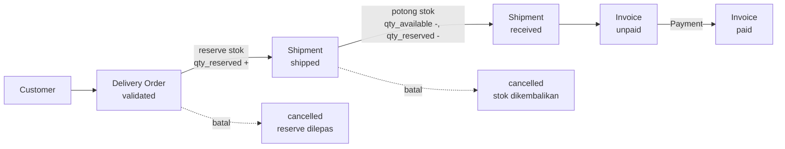
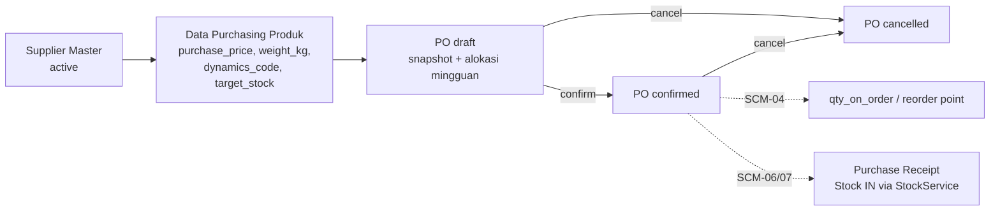

# Gambaran Aplikasi — Smart ERP PT TADCo Transport Perkasa

Dokumen ini menjelaskan **apa** aplikasi ini, **bagaimana** ia disusun, dan **di mana batas kemampuannya saat ini** (per 29 Oktober 2026). Isinya hasil audit langsung terhadap kode di `C:\laragon\www\ERP-Tadco`, bukan rencana.

- Repo: `https://github.com/chsryn/ERP-Tadco`
- Jenis: ERP distribusi barang (Laravel monolith, server-rendered)
- Domain bisnis: distribusi bahan pangan (terigu, dsb.) ke customer ritir/grosir dengan alur pesanan → pengiriman → tagihan → pembayaran, ditambah alur pembelian ke supplier/principal.

---

## 1. Ringkasan

Smart ERP TADCo adalah aplikasi web internal untuk mengelola:

1. **Master data** — customer, produk, supplier.
2. **Persediaan** — saldo stok per produk, kartu stok, penyesuaian manual.
3. **Penjualan (outbound)** — Delivery Order, Shipment, Invoice, Payment.
4. **Pembelian (inbound / SCM)** — Supplier Master, Data Purchasing produk, Purchase Order, rekomendasi Auto PO (draft).
5. **Laporan** — stok, penjualan, piutang, pembayaran (dengan ekspor Excel).
6. **Asisten AI read-only** — ringkasan data sesuai role, tanpa kemampuan menulis.

ERP adalah **source of truth**. Lapisan AI hanya membaca dan menjelaskan, tidak pernah mengubah data.

Prinsip yang dipegang di repo ini:

- Penulisan stok hanya lewat jalur resmi (`StockService`, penyesuaian inventory, shipment), bukan dari modul lain.
- Transaksi multi-tabel dibungkus `DB::transaction` dengan `lockForUpdate()`.
- Identitas user selalu diambil dari session (`auth()->id()`), tidak pernah dari input pengguna/LLM.
- Uang disimpan `decimal(15,2)`, bukan float.

---

## 2. Teknologi

| Lapisan | Teknologi |
| --- | --- |
| Bahasa / runtime | PHP `^8.3` |
| Framework | Laravel `^13.8` |
| Database | MySQL (dev: Laragon `erp_tadco`), SQLite in-memory untuk test |
| Otorisasi | `spatie/laravel-permission ^8` (role: `admin`, `sales`, `finance`) |
| Excel | `maatwebsite/excel` + `phpoffice/phpspreadsheet` |
| Tampilan | Blade + Bootstrap 5.3.3 (CDN) + Bootstrap Icons + `public/css/metronic.css`, JavaScript vanilla inline (tanpa build step di layout) |
| Test | PHPUnit 12, `RefreshDatabase`, feature test |
| Gaya kode | Laravel Pint |

Tidak ada SPA, tidak ada API publik, tidak ada queue worker wajib. Semua route web ada di `routes/web.php`.

---

## 3. Arsitektur

```text
routes/web.php
   │  middleware: auth, role:admin, role:admin|sales|finance, throttle
   ▼
app/Http/Controllers/*          ← tipis: validasi request, panggil service, kembalikan view
   │  app/Http/Requests/*       ← validasi terstruktur (khusus modul tertentu)
   ▼
app/Services/*                  ← aturan bisnis + transaksi DB + lock
   │  app/Services/Ai/*         ← snapshot read-only untuk AI
   ▼
app/Models/* (Eloquent)         ← relasi, cast, sebagian logika model (Invoice: generate nomor, due date)
   ▼
database/migrations/*           ← skema
resources/views/* (Blade)       ← presentasi
```

Pola yang konsisten dipakai:

- **Thin controller.** Logika transaksi ada di service (`DeliveryOrderService`, `InvoiceService`, `PaymentService`, `PurchaseOrderService`, `StockService`).
- **FormRequest** dipakai untuk entitas yang punya aturan kompleks (`StorePurchaseOrderRequest`, `UpdatePurchaseOrderRequest`, `StoreSupplierRequest`, `UpdateSupplierRequest`, `AiChatRequest`). Modul lama memakai `$request->validate()` inline.
- **Layout tunggal** `resources/views/layouts/app.blade.php`: sidebar navy, topbar dengan pencarian global, area konten. Semua halaman mengikuti `@extends('layouts.app')` + `@section('content')`.
- **Naming route**: resource plural (`customers.index`), modul baru memakai snake_case (`purchase_orders.index`) dengan URL kebab (`/purchase-orders`).

---

## 4. Peta modul

| Modul | Entitas utama | Route | Akses |
| --- | --- | --- | --- |
| Autentikasi | `users` | `/login`, `/register`, `/logout` | guest / auth |
| Dashboard | agregat banyak tabel | `/dashboard` | auth |
| Pencarian global | customer + produk | `/search/global` | auth |
| Master Customer | `customers` | `/customers` | auth |
| Master Produk | `products`, `product_discounts` | `/products` | auth |
| Master Supplier (SCM-01) | `suppliers` | `/suppliers` | `role:admin` |
| Purchase Order (SCM-03) | `purchase_orders`, `purchase_order_items`, `document_sequences` | `/purchase-orders` | `role:admin` |
| Auto PO / Reorder (SCM-04) | `products`, `stock_balances`, `purchase_orders` (real-time, tanpa tabel baru) | `/purchase-orders/reorder` | `role:admin` |
| Persediaan | `stock_balances`, `stock_movements` | `/inventory`, `/inventory/adjustment` | auth |
| Delivery Order | `delivery_orders`, `delivery_order_items` | `/delivery-orders` | auth |
| Shipment | `shipments` | `/shipments` | auth |
| Invoice | `invoices`, `invoice_items` | `/invoices` | auth |
| Payment | `payments` | `/payments` | auth |
| Laporan | — | `/reports/{stock,sales,receivables,payments}` | auth |
| Import Excel | customer + produk | `/imports` | auth |
| User Management | `users` + role | `/users` | auth (menu hanya admin) |
| AI Assistant | snapshot per role | `POST /ai/chat` | `role:admin\|sales\|finance` + throttle |

Data awal: `DatabaseSeeder` → role (`admin`, `sales`, `finance`), admin user, produk, supplier (EPFM/TOP 30), dummy data.

---

## 5. Alur bisnis

### 5.1 Outbound — penjualan dan penagihan



Detail perilaku:

- **DO dibuat** → status `validated`, stok **direservasi** (`qty_reserved += qty`) setelah cek `qty_available - qty_reserved` cukup. Harga memakai `products.base_price` dikurangi `product_discounts` yang cocok dengan qty.
- **Shipment dibuat** → status `shipped`, stok **dipotong** (`qty_available -=`, `qty_reserved -=`) dan `stock_movements` tipe `out` dicatat lewat `StockService`. DO menjadi `shipped`.
- **Mark received** → shipment `received`, DO `delivered`. Tidak memotong stok lagi.
- **Invoice** dibuat **manual** dari DO berstatus `shipped`; item disalin, `due_date = invoice_date + payment_term_days`, status `unpaid`.
- **Payment** mengurangi `receivable_amount`; invoice menjadi `paid` bila sisa 0. Pembayaran bisa dihapus dan saldo dihitung ulang.
- Invoice yang sudah ada pembayaran tidak bisa dibatalkan; shipment yang sudah `received` tidak bisa dibatalkan.

### 5.2 Inbound — pengadaan (SCM)



Yang **sudah** ada: supplier, data pembelian produk, PO draft/confirm/cancel, nomor PO concurrency-safe, snapshot produk, PPN 11% snapshot.

Yang **belum** ada: purchase receipt, stock IN dari pembelian, `qty_on_order`, reorder point, auto PO, cetak/PDF PO, kirim PO via email/WhatsApp.

**PO tidak menyentuh stok sama sekali.** Stok baru bertambah saat penerimaan barang dibuat di fase berikutnya.

---

## 6. Model data

### 6.1 Master

| Tabel | Isi penting |
| --- | --- |
| `users` | name, email, password, `is_active`, role via Spatie |
| `customers` | `customer_code`, `customer_name`, wilayah (province/city/district/sub_district), `address`, `is_active`, soft delete |
| `products` | `product_code`, `product_name`, `base_price` (harga jual), `uom` (`BOX`/`SACK`), `net_weight` (teks), `segment`, `is_active`, soft delete + kolom SCM-02: `dynamics_code`, `purchase_price`, `weight_kg`, `target_stock` |
| `product_discounts` | diskon per `strata_level` (S1–S3 untuk SACK, S1–S5 untuk BOX) dengan rentang `min_qty`/`max_qty` |
| `suppliers` | `code`, `name`, `region`, `port_depo`, `delivery_mode`, `term_of_payment_days`, `pic_name`, `is_active` |

### 6.2 Persediaan

| Tabel | Isi penting |
| --- | --- |
| `stock_balances` | satu baris per produk: `qty_available`, `qty_reserved` |
| `stock_movements` | kartu stok: `movement_date`, `movement_type` (`in`, `out`, `return`, `damage`, `adjustment_in`, `adjustment_out`), `qty`, `source_type`, `source_id`, `notes`, `created_by` |

### 6.3 Penjualan

| Tabel | Isi penting |
| --- | --- |
| `delivery_orders` | `do_number` unik, `customer_id`, `sales_id`, `do_date`, `planned_delivery_date`, `received_date`, `total_amount`, status (`validated`/`shipped`/`delivered`/`cancelled`), soft delete |
| `delivery_order_items` | `qty`, `base_price`, `discount_percentage`, `final_price`, `line_total` |
| `shipments` | `shipment_number`, `delivery_order_id`, tanggal kirim/terima, driver, kendaraan, status (`shipped`/`received`/`cancelled`) |
| `invoices` | `invoice_number` unik, `delivery_order_id` unik, `customer_id`, `invoice_date`, `payment_term_days`, `due_date`, `subtotal`, `grand_total`, `paid_total`, `receivable_amount`, status (`unpaid`/`paid`/`cancelled`), soft delete |
| `invoice_items` | salinan item DO: `qty`, `base_price`, `discount_percentage`, `final_price`, `line_total` |
| `payments` | `payment_number`, `invoice_id`, `payment_date`, `payment_method`, `amount`, `bank_name`, `reference_no`, soft delete |

### 6.4 Pembelian (SCM)

| Tabel | Isi penting |
| --- | --- |
| `document_sequences` | counter nomor dokumen: `document_type`, `period` (`YYYY-MM`), `last_number`; **unik** `(document_type, period)` |
| `purchase_orders` | `po_number` unik, `period`, `supplier_id`, `po_date`, status, `subtotal`, `special_discount_total`, `ppn_rate`, `ppn_amount`, `grand_total`, `created_by`, `notes` |
| `purchase_order_items` | `product_id` + snapshot `dynamics_code`, `weight_kg`, `price`; `qty_plan`, `qty_ton`, `week_1..week_4`, `special_discount`, `price_nett`, `total_price`, `qty_received` |

### 6.5 Relasi kunci

```text
Customer 1─n DeliveryOrder 1─n DeliveryOrderItem n─1 Product
DeliveryOrder 1─1 Shipment
DeliveryOrder 1─1 Invoice 1─n InvoiceItem n─1 Product
Invoice 1─n Payment
Product 1─n StockBalance
Product 1─n StockMovement
Supplier 1─n PurchaseOrder 1─n PurchaseOrderItem n─1 Product
User 1─n (DeliveryOrder.sales_id, PurchaseOrder.created_by, semua created_by)
```

Delete behavior penting: `delivery_order_id` pada invoice `RESTRICT`, `customer_id` `RESTRICT`, `supplier_id` pada PO `RESTRICT`, item PO `CASCADE` bila PO dihapus, `created_by` `SET NULL`.

---

## 7. Penomoran dokumen

Tiga pola berbeda hidup berdampingan — ini disengaja (warisan vs standar baru):

| Dokumen | Format | Mekanisme | Catatan |
| --- | --- | --- | --- |
| Delivery Order | `DO-20261029HHMMSS-123` | timestamp + random | praktis unik, tidak berurutan |
| Shipment | `SHP-20261029HHMMSS-123` | timestamp + random | idem |
| Payment | `PAY-20261029HHMMSS-123` | timestamp + random | idem |
| Invoice | `932/SI/TTP/X/2026` | `Invoice::booted()` ambil `orderByDesc('id')->first()` lalu +1 | **rawan duplikasi** pada request bersamaan |
| Purchase Order | `001/09/2026` | `document_sequences` + `lockForUpdate()` | concurrency-safe, urut per bulan |

Nomor PO:

```text
{sequence}/{bulan}/{tahun}   →  001/09/2026, 002/09/2026, ...
sequence reset setiap periode (YYYY-MM); Oktober mulai 001/10/2026
```

Mekanisme PO (di dalam transaksi yang sama dengan insert PO):

```php
DB::table('document_sequences')->insertOrIgnore([... 'last_number' => 0]);   // baris ada, bebas race
$row = DB::table('document_sequences')->where(...)->lockForUpdate()->first(); // serialisasi increment
$number = $row->last_number + 1;                                             // UNIQUE(document_type, period) sebagai pengaman akhir
```

Tanpa `MAX()`, tanpa cache, tanpa file counter. Bila insert PO gagal, sequence ikut rollback sehingga nomor dipakai ulang (tidak ada gap). Gap hanya muncul bila `period` draft diubah.

---

## 8. Perhitungan uang

| Area | Cara |
| --- | --- |
| Database | `decimal(15,2)` untuk semua nominal, `decimal(15,4)` untuk qty/ton |
| DO & Invoice | float + `round(..., 2)` per langkah |
| Payment | float + `round(..., 2)` per langkah, `max(0, ...)` pada sisa piutang |
| Purchase Order | **integer sen** (`cents()`), baru dibagi 100 di akhir |

Aturan PO:

```text
price_nett     = price - special_discount          (discount nominal per unit)
total_price    = qty_plan × price_nett
subtotal       = Σ total_price
discount_total = Σ (qty_plan × special_discount)
ppn_amount     = subtotal × ppn_rate / 100         (default 11.00, disimpan per PO)
grand_total    = subtotal + ppn_amount
qty_ton        = qty_plan × weight_kg / 1000       (4 desimal)
```

Harga PO adalah **excl. PPN**. `ppn_rate` disimpan sebagai snapshot agar histori tidak bergantung konfigurasi global.

Alokasi mingguan PO: `W1 = W2 = W3 = floor(qty/4)`, `W4 = sisa`. Jika user mengisi sendiri, total W1–W4 wajib sama dengan `qty_plan`.

---

## 9. Otorisasi

- Semua route selain `/login` dan `/register` berada di middleware `auth`.
- Middleware `role` berasal dari Spatie Permission (registrasi alias di bootstrap aplikasi).
- Modul PO dan Supplier: `role:admin`.
- AI Assistant: `role:admin|sales|finance` + `throttle:20,1` (dari `config/ai.php`).
- Sidebar menyembunyikan menu berdasarkan `@role`, tetapi **penyembunyian menu bukan pengaman** — pengaman tetap middleware di route.

Keterbatasan yang masih nyata:

- Modul customer, produk, inventory, DO, shipment, invoice, payment, laporan, import, dan user management masih `auth` saja (belum ada pemisahan role per modul).
- Registrasi publik terbuka; user baru langsung login.
- `AuthController::login` tidak mengecek `users.is_active`, sehingga akun nonaktif tetap bisa masuk.
- Belum ada Policy/permission granular (rencana P0b).

---

## 10. AI Assistant (read-only)

- Controller: `AiChatController` (single action) → `AiAssistantService`.
- Konteks dibangun `AiContextBuilder` **per role**: `admin` (agregat seluruh ERP), `sales` (hanya DO miliknya sendiri), `finance` (invoice, piutang, pembayaran).
- Snapshot dikirim sebagai JSON ke provider LLM, instruksi sistem melarang mengarang angka dan melarang aksi tulis.
- Tidak ada tool/function calling. Tidak ada jalur tulis ke database.
- Pengaman tambahan: `DB::listen` menolak SQL selain `select/show/describe/explain/with` selama snapshot dibangun.
- Default **nonaktif**: `AI_ASSISTANT_ENABLED=false`; tanpa `AI_API_KEY` endpoint mengembalikan pesan "belum diaktifkan".

Belum ada: audit log interaksi AI (`AiInteraction`), evaluation suite, agent loop, write action.

---

## 11. Laporan, import, pencarian

- **Laporan**: stok, penjualan, piutang, pembayaran. Masing-masing punya tombol ekspor Excel (`reports/*/export`) memakai PhpSpreadsheet.
- **Import Excel**: satu file master (customer + item) via `TadcoMasterImport` (`maatwebsite/excel`).
- **Pencarian global**: topbar mengetik ≥2 karakter → `/search/global` mengembalikan JSON customer & produk, ditampilkan di dropdown dengan navigasi keyboard.
- **Dashboard**: total customer/produk, stok tersedia & reserved, DO/shipment/invoice, piutang, pembayaran, stok rendah (≤10), transaksi terbaru, dan grafik batang 7 hari (inbound vs outbound) dari `stock_movements`.

---

## 12. Struktur direktori penting

```text
app/
  Http/Controllers/     17 controller + base (thin)
  Http/Requests/        FormRequest (PO, Supplier, AI)
  Models/               17 model Eloquent
  Services/             DeliveryOrderService, InvoiceService, PaymentService,
                        PurchaseOrderService, ReorderService, StockService
  Services/Ai/          AiAssistantService, AiContextBuilder
  Exports/ Imports/     Excel
database/
  migrations/           29 migration (urut waktu)
  seeders/              role, admin, produk, supplier, dummy
resources/views/
  layouts/app.blade.php layout tunggal
  {customers,products,suppliers,purchase_orders,delivery_orders,
   shipments,invoices,payments,inventory,reports,imports,users,auth,dashboard}/
tests/Feature/          9 file, 60 test
routes/web.php          seluruh route web
```

---

## 13. Test dan kualitas

| Perintah | Hasil terakhir |
| --- | --- |
| `php artisan test --testsuite=Feature` | **60 passed**, 215 assertions |
| `php artisan test` (polos) | gagal — `tests/Unit` tidak ada (pre-existing) |

Cakupan test yang ada: `PaymentServiceTest`, `InvoiceServiceTest`, `InvoiceModelTest`, `DeliveryOrderServiceTest`, `AiChatEndpointTest`, `SupplierTest` (10), `ProductPurchasingTest` (10), `PurchaseOrderTest` (21), `ReorderTest` (28). Total Feature suite: 88 test / 281 assertion.

Test memakai SQLite in-memory (`phpunit.xml`) dengan `RefreshDatabase`. **Jangan** mengarahkan test ke database MySQL dev — `RefreshDatabase` akan mengosongkannya.

---

## 14. Batasan dan utang teknis (terverifikasi di kode)

Urusan fungsional:

1. **Belum ada penerimaan barang pembelian** (purchase receipt) dan **stock IN dari PO** — stok hanya bertambah lewat penyesuaian manual atau impor/dummy.
2. **Belum ada reorder point / auto PO** (`qty_on_order` belum ada).
3. **Belum ada cetak/PDF final PO** maupun pengiriman PO ke supplier (email/WhatsApp).
4. **Invoice belum bisa dibuat otomatis dari shipment** — masih manual dari DO `shipped`.
5. **Tidak ada audit trail perubahan data ERP** (hanya `stock_movements` dan `created_by`).

Keamanan / konsistensi:

6. Nomor invoice berpotensi duplikat (pola `orderByDesc('id')`); PO sudah benar, invoice belum.
7. Modul ERP lama masih `auth` saja; registrasi publik; `is_active` user diabaikan saat login.
8. Perhitungan uang tidak seragam (float di DO/Invoice/Payment vs integer sen di PO).

Kode yang sudah tidak sinkron (pre-existing, belum diperbaiki):

9. `app/Models/ProductPrice.php` memakai tabel `product_prices` yang **tidak punya migration**.
10. `app/Exports/StockReportExport.php` masih mereferensikan relasi `warehouse` yang sudah dihapus.
11. `app/Imports/ProductsImport.php` menulis kolom `uom_secondary` yang tidak ada.
12. `ProductController@index` memakai rantai `orWhere` tanpa grouping sehingga filter bisa bocor.

---

## 15. Roadmap

Prioritas proyek (dari `AGENTS.md`):

```text
P0a  Registrasi publik, is_active saat login, role middleware modul sensitif
P0b  Ownership filter (sales_id) + Policy/permission granular
P1   AI Gateway (interface + 2 adapter)
P2   Read-only DB connection untuk AI
P3   AiInteraction audit log
P4   Evaluation / security testing
P5   Optional read-only tools
```

Roadmap SCM:

```text
SCM-01  Supplier Master                    selesai
SCM-02  Product Purchasing Data            selesai
SCM-03  Purchase Order Foundation          selesai
SCM-04  Auto PO / Reorder Point            selesai (rekomendasi + draft)
SCM-05  Print / Confirm Order final        berikutnya (belum)
SCM-06  Purchase Receipt                   belum
SCM-07  Stock IN via StockService          belum
```

Rumus reorder yang dipakai SCM-04 (`app/Services/ReorderService.php`):

```text
available_for_reorder = qty_available - qty_reserved
suggested_qty = target_stock - available_for_reorder - qty_on_order
suggested_qty di-clamp ke 0
```

---

## 16. Menjalankan aplikasi

```bash
composer install
cp .env.example .env        # Windows: copy .env.example .env
php artisan key:generate
php artisan migrate --seed  # butuh MySQL aktif (Laragon)
php artisan serve
```

Test:

```bash
php artisan test --testsuite=Feature
```

`php artisan db:seed --class=SupplierSeeder` sudah dijalankan di MySQL dev (`SUP-EPFM` / EPFM, aktif). Isi `target_stock`, `purchase_price`, dan `weight_kg` produk agar produk muncul di `/purchase-orders/reorder`.

---

## 17. Ringkasan satu paragraf

Smart ERP TADCo adalah monolith Laravel server-rendered untuk distribusi barang: master customer/produk/supplier, persediaan berbasis `stock_balances` + kartu stok, alur penjualan DO → Shipment → Invoice → Payment dengan reservasi dan pemotongan stok yang dijaga transaksi, laporan Excel, serta fondasi pengadaan (supplier → data purchasing produk → PO draft/confirm → rekomendasi Auto PO) dengan penomoran concurrency-safe dan snapshot harga. Lapisan AI bersifat read-only, nonaktif secara default, dan dibatasi per role. Yang belum ada: penerimaan barang, stock IN dari pembelian, cetak PO final, dan audit trail menyeluruh.

---

*Dokumen ini menggambarkan kondisi kode per 29 Oktober 2026. Jika ada perubahan skema/alur, perbarui file ini bersamaan dengan catatan Obsidian terkait.*
